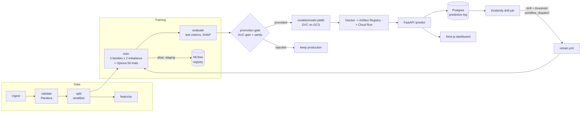
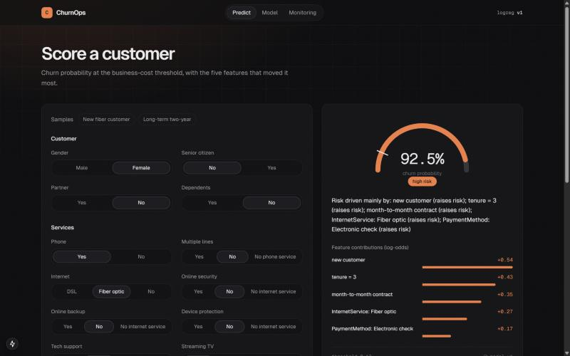
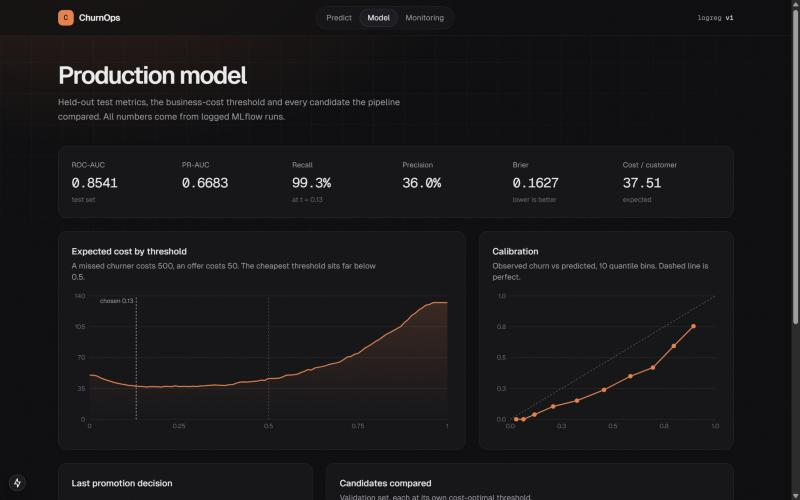
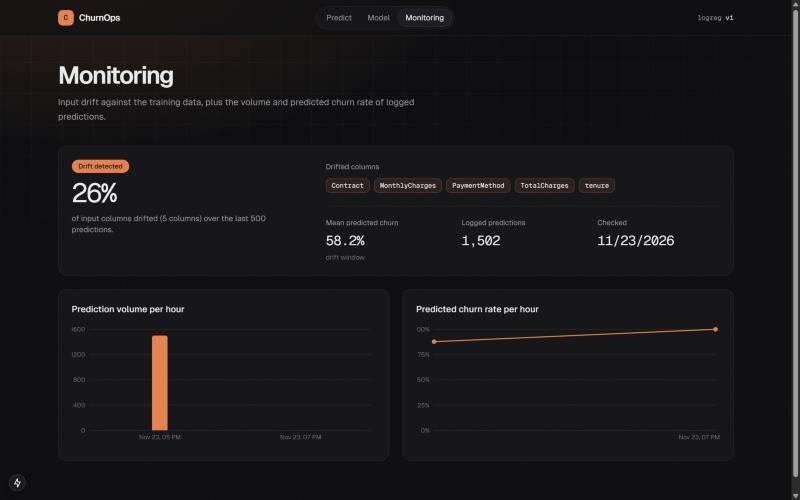

# ChurnOps

End-to-end MLOps pipeline for customer churn: versioned data, tracked experiments, a gated model registry, CI/CD to Cloud Run, drift monitoring that triggers retraining, and SHAP-explained predictions.


**Live demo:** _TBD after first deploy_ · **Demo GIF:** _placeholder — `docs/demo.gif`_

Dataset: [IBM Telco Customer Churn](https://www.kaggle.com/datasets/blastchar/telco-customer-churn) (7,043 customers, 26.5% churn).

---

## Architecture



All DVC stages: `ingest → validate → split → featurize → train → evaluate`. `dvc repro` reruns only stages whose code, data or params changed.

---

## Model comparison

All numbers below are copied from `reports/model_comparison.md`, generated by `src/train/evaluate.py` from logged MLflow runs (run IDs in the last column). Threshold per row = the cost-optimal threshold on the validation set.

| family | imbalance | val ROC-AUC | val PR-AUC | val F1 | val Brier | threshold | val cost/cust | MLflow run |
|---|---|---|---|---|---|---|---|---|
| logreg | class_weight | 0.8352 | 0.6439 | 0.5206 | 0.1659 | 0.13 | 40.40 | `c082a233` |
| logreg | smote | 0.8344 | 0.6435 | 0.5399 | 0.1641 | 0.16 | 40.11 | `0beb01f4` |
| random_forest | smote | 0.8317 | 0.6200 | 0.5151 | 0.1526 | 0.10 | 40.63 | `4c2a844a` |
| xgboost | smote | 0.8306 | 0.6346 | 0.5646 | 0.1427 | 0.10 | 40.21 | `9eda1208` |
| random_forest | class_weight | 0.8303 | 0.6267 | 0.5131 | 0.1601 | 0.12 | 40.54 | `675fbff0` |
| lightgbm | class_weight | 0.8244 | 0.6165 | 0.5524 | 0.1618 | 0.11 | 39.36 | `27c05c84` |
| lightgbm | smote | 0.8234 | 0.6136 | 0.5296 | 0.1468 | 0.05 | 40.73 | `031a11ee` |
| xgboost | class_weight | 0.8231 | 0.6167 | 0.5489 | 0.1631 | 0.12 | 40.26 | `5269e25c` |

Tuned candidate (logreg/class_weight, 50 Optuna trials, run `0018d416`) on the held-out **test** set:

| ROC-AUC | PR-AUC | precision | recall | F1 | Brier | threshold | cost/cust |
|---|---|---|---|---|---|---|---|
| 0.8541 | 0.6683 | 0.3596 | 0.9929 | 0.5280 | 0.1627 | 0.13 | 37.51 |

**Findings**
- Logistic regression won. On 7k rows of mostly categorical data, boosted trees did not beat a linear model at default-ish settings. Optuna tuning (5-fold CV on train) did not change the ranking: tuned val ROC-AUC 0.8346 vs 0.8352 untuned.
- Class weights vs SMOTE: within ±0.008 ROC-AUC everywhere. SMOTE helped XGBoost; class weights helped LightGBM. No consistent winner, so the simpler option (class weights, no synthetic rows) is kept.
- Calibration: class-weighted models are deliberately over-confident on churn (Brier ~0.16), see `reports/calibration.png`. Probabilities are used for ranking + a cost threshold, not read as literal churn odds.

### Business-cost threshold

`params.yaml → cost`: a missed churner costs **500**, one retention offer costs **50** (assumptions, not measured). Expected cost per customer at threshold t:

```
cost(t) = (FN(t) * 500 + flagged(t) * 50) / N
```

The threshold minimising this on the **validation** set is **0.13**, not 0.5. Because a miss is 10x the price of an offer, it is cheaper to offer to ~73% of customers and catch 99% of churners (test recall 0.9929) than to be precise. Change the two numbers and the threshold moves; the cost curve is `reports/cost_curve.png`.

---

## Drift → retrain story

Real log: [`reports/drift_loop.log`](reports/drift_loop.log). Local run, API on port 8001, SQLite prediction log.

1. **Control batch** (500 customers resampled from test, no shift) → `drift_share = 0.05` (1/19 columns: `tenure`) → **no drift**.
2. **Drifted batch** (`simulate_drift.py`: 80% month-to-month, charges ×1.25, 60% electronic check, tenure ×0.5) → mean predicted churn rose from 0.404 to 0.582.
3. **Drift check** → `drift_share = 0.26` (5/19: Contract, MonthlyCharges, PaymentMethod, TotalCharges, tenure) > threshold 0.2 → **drift detected** → `workflow_dispatch` to `retrain.yml` (locally skipped: no `GITHUB_TOKEN`).
4. **Retrain** → `dvc repro`: data unchanged, so train/evaluate were skipped (cached).
5. **Promotion gate** → `promoted=False: ROC-AUC gain +0.0000 < required +0.0050` → production kept, no redeploy.

Step 5 is the honest outcome. Drift in *inputs* without new *labels* cannot produce a better model. Retraining only helps once labelled outcomes for the drifted period come in. The gate stops a pointless redeploy.

Note on threshold: the first run used 0.3 and did not fire (0.26). Four shifted inputs out of 19 columns can never reach 30%, so the threshold was lowered to 0.2. The control batch still stays well below it (0.05).

Evidently report: `docs/screenshots/drift_report.html`.

## Dashboard

Next.js 15 + Tailwind v4 + Motion (`dashboard/`). Dark by default, light follows the OS. The Predict form is built from the API's OpenAPI schema, so its options come from the same constants as Pandera and Pydantic. Charts use JSON from `/reports` and `/monitoring/stats` (same MLflow run), not static images.

| Predict | Model | Monitoring |
|---|---|---|
|  |  |  |

```bash
cd dashboard && npm install && NEXT_PUBLIC_API_URL=http://localhost:8000 npm run dev
```

Deploy: Vercel, root `dashboard/`, env `NEXT_PUBLIC_API_URL=<Cloud Run URL>`. Set `ALLOWED_ORIGINS=<Vercel URL>` on the Cloud Run service for CORS.

---

## Key decisions and trade-offs

| Decision | Why | Failure it prevents |
|---|---|---|
| **DVC** for data + model artifact | `dvc.lock` pins exact data/model hashes per commit; stage caching | "Which data trained the prod model?" with no answer; full retrain on every change |
| **Pandera schema, `strict=True`** | Fails loudly on new categories, type changes, churn-rate shift | Silent training on corrupted upstream data |
| **One schema module** (`src/data/schema.py`) feeds Pandera *and* Pydantic | Training and API agree on what valid input is | API accepting values the model never saw |
| **Features inside the sklearn Pipeline** | Serving calls the same `FeatureEngineer` code; one artifact | Training/serving skew (tested: `tests/test_features.py`, `test_served_equals_offline`) |
| **MLflow** tracking + registry aliases | Every metric traceable to a run; `staging`/`production` aliases (stages are deprecated in MLflow ≥2.9) | Unreproducible "best model" claims |
| **Promotion = deployed artifact is source of truth** | `models/model.joblib` (DVC/GCS) is production; MLflow alias mirrors it | CI needing a paid, always-on MLflow server; registry and deploy disagreeing |
| **Gate: AUC gain ≥ 0.005 AND sanity** (positive-rate band, non-constant scores, p95 latency ≤ 100 ms, gender AUC gap ≤ 0.05) | Small noisy gains don't trigger deploys; broken models never ship | Degenerate or slower models reaching prod |
| **Baked model in the image** (vs loading from MLflow at startup) | Image tag = model version, no runtime dependency, fast cold start on Cloud Run | Outage when the tracking server is down. Cost: a new model needs a new image (automated by `retrain.yml`) |
| **Threshold by business cost on val** | Decision matches money, not F1 | Optimising a metric nobody pays for |
| **Optuna objective = CV on train** | 50 trials can't overfit the val set used for threshold/selection | Optimistic val metrics |
| **Workload Identity Federation** | GitHub OIDC token → short-lived GCP creds | Leaked long-lived JSON keys |

---

## CI/CD

| Workflow | Trigger | Does |
|---|---|---|
| `ci.yml` | every push / PR | ruff, mypy, ingest+validate+split (public data, no creds), pytest |
| `deploy.yml` | push to `main`, called by retrain | `dvc pull` model → build → push to Artifact Registry → `gcloud run deploy` |
| `retrain.yml` | manual, weekly cron, drift dispatch | `dvc pull` → `dvc repro` → promote → if promoted: `dvc push`, commit pointer, call deploy |
| `monitor.yml` | daily | Evidently drift on last 500 logged predictions → dispatch retrain if over threshold |

### GCP setup (one-time, Workload Identity Federation)

```bash
PROJECT=your-project-id; REGION=asia-south1; REPO=OWNER/churnops
gcloud services enable run.googleapis.com artifactregistry.googleapis.com iamcredentials.googleapis.com secretmanager.googleapis.com
gcloud artifacts repositories create churnops --repository-format=docker --location=$REGION
gsutil mb -l $REGION gs://$PROJECT-churnops-dvc
gcloud iam service-accounts create churnops-ci
SA=churnops-ci@$PROJECT.iam.gserviceaccount.com
for r in run.admin artifactregistry.writer storage.objectAdmin iam.serviceAccountUser secretmanager.secretAccessor; do
  gcloud projects add-iam-policy-binding $PROJECT --member=serviceAccount:$SA --role=roles/$r; done
gcloud iam workload-identity-pools create github --location=global
gcloud iam workload-identity-pools providers create-oidc github --location=global --workload-identity-pool=github \
  --issuer-uri=https://token.actions.githubusercontent.com \
  --attribute-mapping=google.subject=assertion.sub,attribute.repository=assertion.repository \
  --attribute-condition="assertion.repository=='$REPO'"
POOL=$(gcloud iam workload-identity-pools describe github --location=global --format='value(name)')
gcloud iam service-accounts add-iam-policy-binding $SA --role=roles/iam.workloadIdentityUser \
  --member="principalSet://iam.googleapis.com/$POOL/attribute.repository/$REPO"
printf '%s' "$NEON_URL" | gcloud secrets create churnops-database-url --data-file=-
dvc remote modify gcs url gs://$PROJECT-churnops-dvc && dvc remote default gcs && dvc push
```

GitHub repo **variables**: `GCP_PROJECT_ID`, `GCP_REGION`, `WIF_PROVIDER` (`$POOL/providers/github`), `WIF_SERVICE_ACCOUNT`. **Secret**: `DATABASE_URL` (for `monitor.yml`). The `attribute-condition` means only this repo can impersonate the service account. No JSON key exists anywhere.

⚠️ **Set a GCP budget alert before the first deploy** (Billing → Budgets & alerts). Cloud Run is capped at `--max-instances 2`.

---

## Local setup

```bash
python -m venv .venv && .venv/Scripts/pip install -r requirements.txt   # or uv
dvc repro                                  # data -> validate -> train -> evaluate
python -m src.registry.promote             # gate -> models/model.joblib
docker compose up --build                  # Postgres + MLflow + API :8000 + dashboard :3000
python -m src.monitoring.simulate_drift && python -m src.monitoring.drift
```

MLflow UI for local runs: `mlflow ui --backend-store-uri sqlite:///mlflow.db`.

---

## What didn't work / what's next

- **Gradient boosting didn't beat logistic regression** on this dataset. It's small and mostly one-hot categorical. Kept the simpler model.
- **Retrain on drift can't improve without new labels**: the loop correctly rejects. A real system needs a label-feedback job: join actual churn outcomes back to logged predictions, then monitor real ROC-AUC, not just input drift.
- **Drift threshold is share-of-columns**, which dilutes targeted shifts. Next: per-feature weights, or prediction drift as a primary signal.
- **Next:** feature store (Feast) once >1 model shares features, shadow deployment (log candidate predictions next to production before promoting), A/B test of the retention offer to measure the real `churn_loss`/`offer_cost`, calibration (isotonic) so probabilities are readable.
